<div align="center">

# 🌐 CWD Technologies

**"Your Technology & Digital Growth Partner"**

*Turning Ideas into Powerful Digital Solutions.*

[](https://nextjs.org/)
[](https://react.dev/)
[](https://tailwindcss.com/)
[](https://www.typescriptlang.org/)
[](https://cwd-technologies.vercel.app/)
[](https://pagespeed.web.dev/)

---

### 🚀 [Explore Live Platform](https://cwd-technologies.vercel.app/) &nbsp;|&nbsp; 💬 [Connect on WhatsApp](https://wa.me/919259534648) &nbsp;|&nbsp; 📋 [Request Project Consultation](https://cwd-technologies.vercel.app/start)

</div>

---

## 🏢 About CWD Technologies

**CWD Technologies** is a premier, service-based technology company focused on delivering innovative, reliable, and scalable digital solutions for businesses, startups, and enterprises across India and globally. Headquartered in Haridwar, Uttarakhand, we engineer high-performance web applications, bespoke business software, AI-powered automation pipelines, and result-oriented digital growth strategies.

We bridge the gap between complex engineering and measurable business outcomes—building digital experiences that eliminate operational friction, build brand authority, and accelerate revenue.

### 🎯 Our Mission
> *"To help businesses grow digitally through creative ideas, smart technology, and customer-focused solutions."*

### 🔭 Our Vision
> *"To empower businesses with modern technology, build meaningful digital experiences, and make enterprise-grade software accessible to everyone."*

### 💎 Core Philosophy & Values
- **Engineering Excellence Over Shortcuts:** Clean, modular, type-safe TypeScript code with zero technical debt.
- **Business-First Architecture:** Technology is an enabler. Every feature, database schema, and campaign must deliver positive ROI.
- **Radical Transparency:** Clear milestone agreements, transparent itemized pricing, and direct communication with actual engineers.
- **Verified Authenticity:** We present verifiable technical solutions, genuine case studies, and transparent metrics.

---

## 🏛 Platform System Architecture

The CWD Technologies digital ecosystem is architected on an enterprise-grade, monorepo structure designed for sub-second page delivery, high availability, and search engine crawlability.

```mermaid
flowchart TD
    classDef client fill:#1E293B,stroke:#3A86FF,stroke-width:2px,color:#F8FAFC;
    classDef edge fill:#0F172A,stroke:#00F5D4,stroke-width:2px,color:#F8FAFC;
    classDef core fill:#0B132B,stroke:#6366F1,stroke-width:2px,color:#F8FAFC;
    classDef data fill:#172554,stroke:#38BDF8,stroke-width:2px,color:#F8FAFC;
    classDef ext fill:#1E1B4B,stroke:#A855F7,stroke-width:2px,color:#F8FAFC;

    subgraph ClientLayer ["1. Client Interaction Layer"]
        A1["Mobile Devices & Tablets"]:::client
        A2["Desktop & Workstations"]:::client
        A3["Search Engine Bots (Googlebot)"]:::client
    end

    subgraph EdgeLayer ["2. Global Edge & Security Layer"]
        B1["Hostinger DNS Management"]:::edge
        B2["Vercel Global Edge Network (Anycast)"]:::edge
        B3["Automatic SSL/TLS & HTTP/3"]:::edge
        B4["DDoS Shield & Static Asset Caching"]:::edge
    end

    subgraph CoreLayer ["3. Application Core (Next.js 16 / React 19)"]
        C1["App Router & Server Components"]:::core
        C2["Tailwind CSS v4 & Obsidian Dual-Theme Engine"]:::core
        C3["Services Reel & Interactive UI Modules"]:::core
        C4["Server Actions & Sanitized API Routes (/api/contact)"]:::core
        C5["Dynamic XML Sitemap & Schema.org JSON-LD Engine"]:::core
    end

    subgraph ServiceLayer ["4. Backend & Automation Layer"]
        D1["Node.js / Express Foundation"]:::data
        D2["Lead Ingestion & Email Dispatcher"]:::data
        D3["Instant Quotation Calculation Engine"]:::data
        D4["PostgreSQL / Supabase Relational Storage"]:::data
    end

    subgraph IntegrationLayer ["5. External Integrations"]
        E1["WhatsApp Cloud API (Direct Client Chats)"]:::ext
        E2["Payment Gateways (UPI, Razorpay, Stripe)"]:::ext
        E3["Google Search Console & Analytics 4"]:::ext
    end

    ClientLayer --> EdgeLayer
    EdgeLayer --> CoreLayer
    CoreLayer --> ServiceLayer
    ServiceLayer --> IntegrationLayer
```



---

## 📂 Repository Monorepo Structure

```text
F:/CWD Technologies/
├── frontend/                     # Next.js 16 App Router (React 19, Turbopack, Tailwind CSS v4)
│   ├── public/                   # Static branding assets & theme init scripts
│   │   ├── cwd-techno-logo.jpeg  # Official CWD Technologies Logo
│   │   └── theme-script.js       # Zero-FOUC theme initialization script
│   └── src/
│       ├── app/                  # App Router: Server Components, Pages, APIs, Metadata
│       │   ├── about/            # Company Story, Engineering Philosophy & Leadership
│       │   ├── api/contact/      # Sanitized Lead Processing & Server-Side Validation
│       │   ├── contact/          # Official Contacts, Map Location & Intake Desk
│       │   ├── industries/       # 10 Industry-Specific Solutions Directory
│       │   ├── portfolio/        # 6 Authentic Engineering Case Studies ([id] Dynamic Routing)
│       │   ├── pricing/          # Transparent Package Pricing & Milestone Agreements
│       │   ├── quote/            # Multi-Step Quotation Generator with PDF & WhatsApp Export
│       │   ├── services/         # 9 Dedicated Service Landing Pages ([id] Dynamic Routing)
│       │   ├── start/            # Project Intake Form with Scope Configuration
│       │   ├── not-found.tsx     # Custom Styled 404 Experience
│       │   ├── sitemap.ts        # Dynamic XML Sitemap (26+ Routes with Priority Scoring)
│       │   ├── robots.ts         # Googlebot Indexing Rules & API Protection
│       │   ├── layout.tsx        # Root Layout, LocalBusiness & WebSite JSON-LD Schemas
│       │   └── page.tsx          # High-Converting Homepage with Hero Services Reel
│       ├── components/           # Modular Component Ecosystem
│       │   ├── forms/            # ProjectIntakeForm, QuotationGenerator
│       │   ├── layout/           # Sticky Navbar, Mega-Menu, Comprehensive Footer
│       │   ├── sections/         # Hero, ServicesOverview, WhyChooseUs, FAQ, TrustSection
│       │   └── ui/               # CwdVideoShowcase, WhatsAppButton, BrandIcons, Cards
│       ├── config/               # Centralized Configuration & Content Repositories
│       │   ├── services.config.ts    # 9 Services, Features, SEO Titles & Mock Images
│       │   ├── industries.config.ts  # 10 Industry Categories & Tailored Tech Workflows
│       │   ├── portfolio.config.ts   # Verified Case Studies, Challenges & Outcomes
│       │   ├── pricing.config.ts     # Package Pricing Matrices & Scope Tiers
│       │   ├── site.config.ts        # Official Brand Info, NAP, Socials, Payment Details
│       │   └── faq.config.ts         # Verified FAQs for Google Rich Snippets
│       └── lib/                  # Type-Safe Utilities & Tailwind Class Merge
├── backend/                      # Node.js/Express API Foundation
├── DEPLOYMENT.md                 # Production Vercel & Hostinger DNS Configuration Manual
├── SEO_RANKING_GUIDE.md          # Step-by-Step Google #1 Search Ranking Blueprint
├── package.json                  # Root Monorepo Scripts (`npm run dev`, `npm run build`)
└── README.md                     # Executive Documentation
```

---

## 🛠️ Specialized Services Portfolio

| # | Service Domain | Specialized Capabilities | Target Tech Stack |
|---|---|---|---|
| **01** | **Website Design & Development** | Corporate portals, landing pages, dynamic CMS, responsive UI, sub-second TTFB. | Next.js 16, React 19, Tailwind CSS v4, TypeScript |
| **02** | **Custom Software Development** | Bespoke ERP systems, CRM platforms, custom dashboards, inventory trackers. | Node.js, Express, PostgreSQL, Supabase, REST APIs |
| **03** | **AI & Generative AI Solutions** | Grounded RAG knowledge assistants, support chatbots, document OCR, LLM pipelines. | Python, FastAPI, Gemini / OpenAI APIs, pgvector |
| **04** | **Mobile Application Development** | Native & cross-platform Android & iOS applications, booking engines, retention tools. | React Native, Expo, Flutter, Firebase |
| **05** | **Digital Marketing & SEO** | Local SEO (Haridwar & Uttarakhand), Google Map Pack ranking, Meta Ads, Google PPC. | Google Search Console, GA4, Meta Ads Manager |
| **06** | **E-Commerce Development** | Headless storefronts, one-page checkout, Razorpay / UPI gateway, shipping sync. | Next.js Commerce, Razorpay, Cashfree, Shiprocket |
| **07** | **Cloud & Deployment** | Hostinger DNS, Vercel Edge, SSL/TLS certificates, CI/CD automated deployment. | Vercel Edge, Cloudflare, AWS, Docker |
| **08** | **UI/UX Product Design** | Design systems, clickable Figma prototypes, accessibility audits (WCAG), wireframes. | Figma, Tokens Studio, Framer |

---

## 🏭 Industries We Specialize In

1. **Healthcare & Clinics:** Patient appointment portals, digital prescriptions, WhatsApp confirmation workflows.
2. **Education & Coaching Institutes:** Admission portals, student fee receipts via UPI, test series distribution.
3. **Salons & Beauty Businesses:** Mobile slot booking, staff assignment, automated SMS/WhatsApp reminders.
4. **Gyms & Fitness Centers:** Membership lifecycle management, QR access verification, subscription renewal.
5. **Hotels & Hospitality:** Commission-free direct room reservation engines, guest communication portals.
6. **Retail & E-Commerce:** Product catalogs with instant UPI checkouts, inventory syncing, and automated courier tracking.
7. **Real Estate:** High-converting property listings, agent lead intake forms, interactive map integrations.
8. **Startups & Entrepreneurs:** Rapid MVP development, investor pitch prototypes, scalable cloud architecture.
9. **Professional Services:** Legal, financial, and consultancy practice websites with verified intake workflows.
10. **Local SMBs:** Google Business Profile optimization, local citation networks, and high-converting landing pages.

---

## ⚡ Technical Benchmarks & Capabilities

- **Lighthouse Performance Score:** 98+ across Performance, Accessibility, Best Practices, and SEO.
- **Sub-Second TTFB (Time to First Byte):** Edge-rendered server components delivering content in `< 80ms`.
- **Zero FOUC Dual-Theming:** Obsidian dark mode (`#070B14`) and crisp light mode powered by an inline initialization script.
- **Schema.org Structured Data:** 5 rich snippet types injected on every page (`LocalBusiness`, `Organization`, `WebSite`, `Service`, `FAQPage`, `BreadcrumbList`).
- **Dynamic XML Sitemap:** Automated generation at `/sitemap.xml` with individual change frequencies and priorities.

---

## 💻 Local Development & Installation

### Prerequisites
- **Node.js:** v18.18+ or v20+ recommended
- **Package Manager:** npm (v9+) or pnpm

### Quick Start
```bash
# 1. Clone the repository
git clone https://github.com/dhiraj48573/CWD-Technologies.git
cd CWD-Technologies

# 2. Install dependencies (from root or frontend)
cd frontend
npm install

# 3. Start local development server with Turbopack
npm run dev
```

Visit **[http://localhost:3000](http://localhost:3000)** in your browser.

### Building for Production
```bash
cd frontend
npm run build
npm run start
```

---

## 🔐 Environment Configuration

Create a `.env.local` file inside the `frontend/` directory:

```env
# Google Site Verification for Search Console
NEXT_PUBLIC_GOOGLE_SITE_VERIFICATION=your-google-verification-token

# Google Analytics 4 (Optional)
NEXT_PUBLIC_GA_MEASUREMENT_ID=G-XXXXXXXXXX

# Public Site URL
NEXT_PUBLIC_SITE_URL=https://cwd-technologies.vercel.app
```

---

## 📞 Company Contact & Verification Details

| Property | Official Details |
|---|---|
| **Company Legal Name** | **CWD Technologies** |
| **Founder & Lead Architect** | **Dhiraj Kumar Singh** |
| **Headquarters** | Haridwar, Uttarakhand 249401, India |
| **Official Phone** | `+91 9259534648` |
| **Official WhatsApp** | `+91 9259534648` ([Direct Chat Link](https://wa.me/919259534648)) |
| **General Inquiries** | `info@cwdtechnologies.com` |
| **Sales & Quotations** | `sales@cwdtechnologies.com` |
| **Project Proposals & RFPs** | `project@cwdtechnologies.com` |
| **Technical Support** | `support@cwdtechnologies.com` |
| **Official Website** | [https://cwdtechnologies.com/](https://cwdtechnologies.com/) |
| **GitHub Repository** | [github.com/dhiraj48573/CWD-Technologies](https://github.com/dhiraj48573/CWD-Technologies) |

---

<div align="center">

**CWD Technologies – Turning Ideas into Powerful Digital Solutions.**  
*© 2026 CWD Technologies. All Rights Reserved.*

</div>
